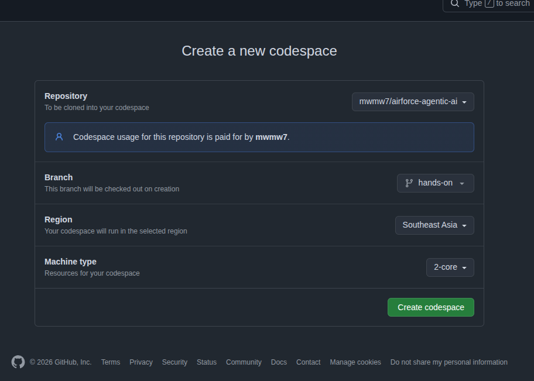

# Air Force AI Center · Agentic AI Design and Implementation — Hands-on Workshop

October 29–30, 2026 (Thursday–Friday) · TypeScript · LangGraph.js · MCP · Jev · Hindsight

**Start the workshop in your browser — no installation required:** Open the button or URL below and select **Create codespace**. See [Section 1-2](#1-2-fastest-path--github-codespaces-no-installation-recommended) for detailed instructions.

[](https://codespaces.new/mwmw7/airforce-agentic-ai?ref=hands-on)

```
https://codespaces.new/mwmw7/airforce-agentic-ai?ref=hands-on
```

> All data in this repository, including radar displays, weather, and the rulebook, is **synthetic training material**. It does not represent actual airspace, military units, aircraft types, or operational regulations.
> The agent provides **recommendations only**. A human always makes the final decision.

---

## Welcome — What You Need to Get Started

### What You Will Build

When a control room receives a **one-line report**, such as “There is a round flying object above Seoul,” an AI agent checks radar, weather, and the rulebook, gathers evidence, and recommends one of three actions: **scramble, monitor, or ignore**. **A human always makes the final decision.**

Starting with a nearly empty agent, you will add capabilities in **eight steps** alongside the instructor. Each time you complete a step and run the agent again, another piece of evidence appears on the operator's screen. By the end, you will have connected the core building blocks of a modern agent yourself: tool calling, MCP, RAG, subagents, human approval, and memory.

### No Need to Worry

- **You do not need to know TypeScript.** Each exercise requires only a few lines. Comments explain what to do, and the instructor writes the code with you. The goal is to understand how the pieces connect, rather than memorize code.
- **No installation is required.** GitHub Codespaces provides a complete development environment in your browser.
- **Every step works without an API key.** Without a key, the project uses **mock mode**, a simulated model with predefined responses. The instructor distributes real model keys to each group during the workshop.
- **You can catch up at any time.** Run `pnpm step <step>` to start from a version with all earlier steps completed.
- **Errors are part of learning.** Read the error message and raise your hand if you need help. Debugging is part of the workshop.

### Before the Workshop (5 Minutes)

- [ ] Create a **GitHub account** and confirm that you can sign in: https://github.com/signup. The workshop assumes the personal-account Codespaces allowance of 60 hours per month on a 2-core machine; approximately 10 hours is enough for both days.
- [ ] Install the latest **Chrome or Edge** on your laptop.
- [ ] Try opening the environment in advance. Follow [Section 1-2](#1-2-fastest-path--github-codespaces-no-installation-recommended), create a codespace, and check for the setup-complete message. Initial creation takes about 2–3 minutes; you can reopen the same environment on the day.
- [ ] Optional: Let the instructor know in advance if your organization blocks github.com.

### 12 Essential Terms

| Term | In Plain English | Where You Will See It |
|---|---|---|
| **LLM** | A language model that reads text and generates a response, such as ChatGPT or Claude | `src/lib/llm.ts` |
| **Agent** | A program in which an LLM chooses what to do next and works toward completing a task | Throughout this repository |
| **Tool** | A function the LLM can request. The model **asks** to call a tool with specific arguments; your code executes it | `look_radar` · `look_weather` … |
| **Agent Loop** | Ask the model → execute tools → return results to the model; repeat until it has enough information | `agent ⇄ tools` |
| **Graph · Node · Edge** | LangGraph's workflow structure: a node is a unit of work, and an edge points to the next step | `addNode` · `addEdge` |
| **State** | A shared whiteboard that nodes read and update. Each node records its results for the next node | `labs/agent/state.ts` |
| **Worker · Subagent** | A component assigned part of the work. Here, a Worker has no internal model loop; a Subagent does | `searchDocs` · `askRadar` |
| **RAG** | Retrieve documents relevant to a question and provide them as supporting evidence | Rulebook retrieval (`search-docs.ts`) |
| **MCP** | A standard protocol for using tools hosted by another program, or server. Connecting a server makes its tools available | Weather server (`mcp-servers/weather`) |
| **Jev** | A decision model that returns **predefined choices and probabilities**, such as scramble, monitor, or ignore. It is designed for faster, more consistent decisions than a general-purpose LLM | `src/lib/jev.ts` |
| **HITL (Human-in-the-Loop)** | Pause the agent at important moments to ask a human. A checkpoint saves the paused state so execution can resume later | `approve` node |
| **Memory** | Store previous decisions and reuse them when the same report arrives | Hindsight (`src/lib/memory.ts`) |

### Reading Terminal Output

Each line printed by `pnpm agent` starts with a **label**. Follow the labels to see what the agent did.

The examples below translate the output into English for reference; the application's existing messages and exercise comments remain in their original language.

```
[REPORT] An unidentified round object is hovering above Seoul …  ← Incoming report
[SETUP ] Model mock · Jev local · Memory file                     ← Current modes
[TOOL  ] search_docs(original report)                             ← Rulebook lookup (Worker)
[SUB   ] ┏━ askRadar radar Subagent                               ← Lines marked ┃ belong to the Subagent
┃ [LLM   ] Call 1 → Use tool: look_radar                           ← The model selects a tool
┃ [TOOL  ] look_radar(…)                                          ← Your code executes it
┃ [MCP   ] look_weather(…)                                        ← Tool on the MCP server
[SUB   ] ┗━ askRadar finished · 4 model calls                      ← Return conclusions to the parent
[MEMORY] No matching case → Ask Jev                               ← Memory lookup
[JEV   ] ▶ scramble 65% …                                         ← Decision model recommendation
[RULE  ] Condition: scramble → Prepare to scramble!                ← Code-based recommendation
[HUMAN ] Review — The operator makes the decision                 ← Ask a human (y / w / n)
[DECIDE] …                                                       ← Human-selected outcome
```

`[STOP]` means the code enforced a stop, such as a call limit or timeout. Add `--watch` to see each node's state inputs and outputs on `[NODE]` lines.

### How Each Step Works

1. The instructor introduces the next step and explains the concept.
2. Open the file: press `Ctrl+P` in VS Code (`Cmd+P` on Mac) and enter its name, such as `main.ts`.
3. Find the exercise: use `Ctrl+F` to search for `TODO N`. Comments below `// ===== TODO N: … =====` explain the task; the bracketed placeholder marks where to write your code.
4. Complete the exercise with the instructor and save with `Ctrl+S`.
5. Run `pnpm agent` in the terminal. **A new line on the operator's screen (`[HUMAN]`) means the step is working.**

### If You Get Stuck

| Situation | What to Do |
|---|---|
| You want to see the solution | Run `git diff hands-on main -- labs/agent/main.ts` to compare the exercise and solution branches. Substitute another file path as needed |
| You missed a step | Run `pnpm step <current-step>` to fill in earlier steps. It asks before overwriting files |
| A process keeps running | Press `Ctrl+C` in the terminal |
| Execution pauses at the operator prompt | This is expected. Enter `y` (scramble), `w` (monitor), or `n` (ignore), then press Enter |
| The environment stopped during lunch | A codespace sleeps after 30 minutes of inactivity. Reopen the same URL; your files are preserved |
| You still need help | Raise your hand. You can also work through it with a neighbor |

### A Few Terminal Basics

- Repeat the previous command: press `↑`.
- Open another terminal: select `+` in the upper-right corner of the terminal panel, for example to keep the weather MCP server running.
- In the terminal, `Ctrl+C` means **stop**, not copy. To copy, select text and right-click. Paste with `Ctrl+V`; your browser may ask for permission the first time.
- Run all `pnpm …` commands in this README from the repository root. Codespaces opens there by default.

### After the Workshop

- To save your work, use **Source Control** in VS Code to commit and push. When needed, VS Code offers to create your own fork.
- When finished, **Stop** or **Delete** your codespace at https://github.com/codespaces to conserve your allowance.
- The complete solution is always on `main`. To repeat the exercises at home, create a new codespace using the same link.

---

## 0. Branch Guide — Read This First

| Branch | Purpose | Intended Users |
|---|---|---|
| `main` | **Complete solution.** All exercise code is implemented | Instructors and learners looking for the solution |
| `hands-on` | **Workshop exercises.** Matches `main`, with selected implementation sections replaced by placeholders and instructional comments | Learners |

Use the `hands-on` branch for the workshop. If you get stuck, consult the solution. Both branches use the same file paths, making comparison straightforward.

```bash
git diff hands-on main -- labs/agent/main.ts
```

---

## 1. Five-Minute Quick Start

### 1-1. Prerequisites (Prepare One Week Before the Workshop)

| Required | Optional |
|---|---|
| Node.js **22 LTS** or later (`node -v`) | Ollama + `ollama pull qwen3:8b` to try a model running on your laptop |
| git, VS Code | A free LangSmith account for LangGraph Studio and execution traces |
| A group token provided by the instructor, entered in `.env` | `uv` to run the Hindsight memory server on your laptop: https://docs.astral.sh/uv/ |

You do not need to install a local LLM. The workshop calls models through OpenRouter, using spending-capped API keys provided to each group by the instructor.

### 1-2. Fastest Path — GitHub Codespaces (No Installation, Recommended)

[](https://codespaces.new/mwmw7/airforce-agentic-ai?ref=hands-on)

All you need is a GitHub account and **a browser**, whether you use Windows, macOS, or Linux. Open the badge above or https://codespaces.new/mwmw7/airforce-agentic-ai?ref=hands-on. On the screen below, confirm that the branch is `hands-on` and the machine type is `2-core`, then select **Create codespace**.



After about 2–3 minutes, VS Code opens in your browser. **Dependency installation, `.env` creation, and environment checks run automatically** in the terminal, using the configuration in `.devcontainer/`. When setup completes, run `pnpm agent`. Open another terminal with `+` and run `pnpm mcp:weather` for the weather MCP server.

- No fork is required to begin. Use `git pull` to receive instructor updates during the workshop. When saving your work afterward, VS Code can create a fork as part of pushing your changes.
- The workshop assumes a personal-account allowance of 60 hours per month on a 2-core machine, with approximately 10 hours needed for the two days. Without paid usage enabled, the environment stops when the allowance is exhausted.
- After 30 minutes of inactivity, the codespace sleeps. Your files remain when you reopen it; restart `pnpm mcp:weather` if it was running.
- Put tokens and keys in `.env`, or add identically named secrets, such as `LLM_API_KEY`, under GitHub **Settings → Codespaces → Secrets**. Codespaces secrets take precedence over `.env`.
- Codespaces forwards the ports for `pnpm see:run` (3030), weather MCP (3333), and Studio (2024).
  - `pnpm see:run`: Watch the agent execute. A browser tab opens automatically; no additional account is required.
  - `pnpm see:graph`: View the graph only. Open `docs/graphs/agent.md` and press `Ctrl+Shift+V`. A Mermaid preview extension is preinstalled.
  - `pnpm see:studio`: Launch the official debugger. The helper makes port 2024 public and prints the Studio URL. A LangSmith login is required. Anyone can access the public URL, so stop the process with `Ctrl+C` after the demonstration.

### 1-3. Local Installation

```bash
git clone https://github.com/mwmw7/airforce-agentic-ai.git
cd airforce-agentic-ai
git checkout hands-on        # Exercise branch with implementation placeholders
corepack enable && corepack prepare pnpm@12.6.0 --activate   # If pnpm is missing; uses Corepack bundled with Node 22
pnpm install
pnpm setup:check             # Check the environment and create .env. Instructor tokens are provided on the day; mock mode works without them.
```

You are ready when the check reports no problems. Informational notices about offline fallback modes do not prevent you from completing the exercises.

### 1-4. First Run

```bash
pnpm mcp:weather                 # Terminal 1: keep the weather MCP server running. Without it, the agent continues without weather.
pnpm agent                       # Terminal 2: report 1 → radar, rulebook, and weather checks → Jev recommendation → human decision
pnpm agent 3                     # Report 3 (1–4), or a custom report such as: pnpm agent "A duck-shaped balloon is floating over the Han River"
pnpm agent:limit                 # Enforce a one-call limit: the code, not the model, stops execution
pnpm agent --watch               # Show inputs and outputs for each node; --watch=full shows everything
pnpm agent --resume <run-id>      # Resume a run interrupted with Ctrl+C during human review. The resume command appears above the prompt after step 7.
pnpm agent --all                 # Run all four reports and summarize them in a table. Answer y/w/n for each, or use --answer w. Compare JEV_MODE=local and typesafe.
LLM_MOCK_SLOW=1 pnpm agent       # Simulate a slow model: interrupt the call and ask the operator to retry / skip / stop
```

See the complete option tables under **All `pnpm agent` Options** in Section 4.

Commands beginning with `see:` let you **visualize the graph**.

| Command | Purpose | Runs the Agent? | Where to View | Account Required |
|---|---|---|---|---|
| `pnpm see:run` | Watch execution with the active node highlighted. Runs randomly selected reports continuously; stop with `Ctrl+C` | Yes | Browser at localhost:3030 | No |
| `pnpm see:graph` | Generate a static graph to inspect the structure after changing edges | No | `docs/graphs/agent.md` in VS Code preview | No |
| `pnpm see:studio` | Use the official LangGraph Studio debugger to enter inputs, step through execution, and inspect state. In Codespaces, the helper handles the public port and URL | Through Studio | smith.langchain.com | LangSmith (`LANGSMITH_API_KEY` in `.env`) |

The `hands-on` branch starts with a **nearly empty agent**. It still runs to completion with the placeholders untouched; the operator's screen simply lacks evidence. Fill in each step and rerun to see new lines appear. If you fall behind, use `pnpm step <current-step>` to complete the earlier steps automatically (Section 3).

In Studio's Input field, provide a single report:

```json
{ "report": "An unidentified round flying object is hovering above Seoul. It is stationary and does not respond to radio calls." }
```

---

## 2. Your Agent at a Glance

When a one-line report arrives, the **rulebook Worker and radar Subagent gather information concurrently**. If memory contains a decision for the same report, the agent reuses it and skips Jev. Otherwise, the decision model provides a recommendation. **A human always reviews all evidence and chooses scramble, monitor, or ignore.** Only after that decision does the LLM write a briefing report, saved exclusively under `reports/`.

```
         ┌─▶ searchDocs (Worker: a function that searches the rulebook) ─┐
START ───┤                                                             ├─▶ remember
         └─▶ askRadar (Subagent: internal agent ⇄ tools loop) ──────────┘

remember ─┬─ Matching case in memory ──────────────────┐  (skip Jev)
          └─ No matching case ─▶ judge (Jev) ──────────┴─▶ approve ─▶ writeReport ─▶ END

approve     = Present radar, close-up, weather, rules, memory, and Jev results; a human decides
writeReport = After the human decision, generate a briefing and save it only under reports/

Inside askRadar (labs/agent/ask-radar.ts):
  START ─▶ agent ─┬─ Requests a tool ─▶ tools ─▶ agent … (repeat)
                 ├─ Has enough information ─▶ END
                 │    Return facts and evidence to the parent; keep conversation history inside the Subagent
                 ├─ Exceeds the step limit ─▶ stop ─▶ END
                 │    Code stops only the Subagent; the parent continues
                 └─ Model is too slow ─▶ askHuman
                      Human chooses: retry → agent / skip → END / stop → stop
```

To LangGraph, both a Worker and a Subagent are simply nodes. We call a node a Subagent when it contains its own model loop. In the terminal, `[SUB] ┏━ askRadar` opens a block; every line inside it is prefixed with a purple `┃`, and a closing `┗━ askRadar` line marks completion. `searchDocs` finishes in one line outside that block. With `--watch`, the block also shows repeated `askRadar › agent` and `askRadar › tools` entries.

| Step (Node) | What It Does | What You Learn |
|---|---|---|
| `searchDocs` (Worker) | Retrieve relevant rulebook entries using the report and add them as evidence. A single function, with no model call | Task decomposition: use a function for a defined task |
| `askRadar` (Subagent) | Wrap the entire agent ⇄ tools loop in a Subagent graph. Return only facts, evidence, and steps to the parent | Subagents and context isolation: the parent receives conclusions |
| `agent` (inside the Subagent) | Ask the model whether to call another tool or summarize the facts | Agent loops and tool calling |
| `tools` (inside the Subagent) | **Your code** executes the model's selected tools. Local radar and close-up tools share a list with the MCP weather tool | The model requests execution; your code performs it |
| `remember` | Look up the same case with `findSameCase`. If report overlap is at least 0.9, reuse the stored decision and skip Jev | Decisions informed by long-term memory; case matching is a code-defined rule |
| `judge` | Recall similar cases and ask Jev three questions: scramble/monitor/ignore, risk level, and the probability that the object is unidentified. Retain the result | Decision models and long-term memory |
| `approve` | **Always** pause and show radar, close-ups, weather, rules, memory, Jev's recommendation, and the code-based recommendation. A human selects y (scramble), w (monitor), or n (ignore). Store the human response in memory | Human-in-the-Loop (`interrupt`) |
| `writeReport` | Run once after the human decision. Code fixes the decision and timestamp in the header; the LLM writes only the briefing prose from the facts shown by `approve`. Save only to `reports/<run-id>.md`, rejecting paths outside that directory. On model failure or in mock mode, save the fact list directly | Code controls facts; the LLM writes prose. Sandboxed file output |
| `askHuman` (inside the Subagent) | Pause when the model is too slow and ask whether to retry, skip, or stop. Nested interrupts are saved and resumed using the parent run ID | Timeouts and human intervention |
| `stop` (inside the Subagent) | Stop only the Subagent when `MAX_STEPS` is exceeded. The parent continues to the decision stage using the rulebook results | Harness controls and fault isolation |

Graph: `docs/graphs/agent.md`. Regenerate it with `pnpm see:graph`.

### Four Tools and One Worker

| Tool or Worker | Execution Location | Data Source |
|---|---|---|
| `look_radar`: inspect radar for the location in the report | Local (`ask-radar.ts`) | With a real model, **the LLM generates a synthetic radar scene based on the report**, once per run and consistent with close-up views. In mock mode or on failure: `data/api/radar-screen.json` |
| `look_closer`: zoom in on a location | Local (`ask-radar.ts`) | Same radar scene as `look_radar` |
| `look_flight_plan`: check today's notified or authorized flight plans; added in step 2 | Local (`ask-radar.ts`) | `data/api/flight-plans.json`. The Jamsil drone show has **no application on file** |
| (Worker) `searchDocs`: retrieve rulebook entries (RAG). Always run by the parent graph, rather than selected by the model | Local (`search-docs.ts`) | `data/docs/rulebook.md` |
| `look_weather`: check weather at the location | **MCP server** (`mcp-servers/weather`) | **The LLM generates synthetic weather for the location and situation** on the server. In mock mode or on failure, a rule table supplies the result |

### Four Sample Reports (`REPORTS` in `labs/agent/main.ts`)

| # | Report | What to Observe |
|---|---|---|
| 1 | An unidentified round flying object above Seoul, with no radio response | A radar search for Seoul finds an object near Namsan and a helicopter near Gwanghwamun. Close-up inspection distinguishes them; Jev recommends scrambling, and a human decides. **On the second run, memory supplies the decision and Jev is skipped** |
| 2 | A giant duck-shaped balloon over the Han River, heading toward Gimpo | The rulebook says to monitor balloons |
| 3 | Dozens of drones above Jamsil | `look_flight_plan` finds no drone-show application. The rulebook says to monitor unauthorized drone swarms |
| 4 | A neighboring unit's training aircraft, following its scheduled route | A routine situation |

---

## 3. Workshop Steps — Build One Capability at a Time

TODO numbers correspond to step numbers. Complete each step with the instructor, rerun `pnpm agent`, and check that **a new line appears on the operator's screen**. See `docs/exercises.md` for step-by-step code and verification instructions.

| Step | What You Add | File (TODO) | Visible Result | Concept |
|---|---|---|---|---|
| 0 | Environment, structure, and the first run; no implementation yet | — | The operator screen contains the report but no evidence | Overall architecture |
| 1 | Attach the radar Subagent with `addNode("askRadar", radarAgent)` | `main.ts` (1) | `[SUB] ┏━ askRadar` block, radar and close-up evidence | Subagents · Agent loops |
| 2 | Add `look_flight_plan` to the Subagent: description and implementation | `ask-radar.ts` (2-1 · 2-2) | `[TOOL] look_flight_plan` and flight-plan evidence | Tool calling: descriptions guide selection |
| 3 | Score each rulebook entry | `search-docs.ts` (3) | Relevant rules with `pnpm agent 2` | RAG |
| 4 | Connect weather through MCP: register the server tool, list tools, and execute them | `server.ts` (4-1) · `mcp.ts` (4-2) | Weather evidence while `pnpm mcp:weather` is running; graceful continuation without weather when it is stopped | MCP |
| 5 | Replace sequential execution with parallel execution and a join | `main.ts` (5) | `--watch` shows `searchDocs` and `askRadar` starting together | Task decomposition · Parallelism |
| 6 | Call Jev with `askJev(…, QUESTIONS)` | `main.ts` (6) | Jev results: confidence, risk, and unidentified-object probability | Decision models |
| 7 | Resume with a human response using `Command({ resume })` | `main.ts` (7) | Human decision prompt; interrupt with `Ctrl+C`, then use `pnpm agent --resume <run-id>` | HITL · Checkpoints |
| 8 | Retrieve and retain memories | `main.ts` (8-1 · 8-2) | On the second identical report: matching case found, Jev skipped | Context · Memory |

**Catch up with `pnpm step <current-step>`.** If the instructor starts step 4, run `pnpm step 4`. Steps 1–3 are filled in, leaving step 4 onward for you to complete. Solutions are taken from `main`.

| Command | Result |
|---|---|
| `pnpm step 1` | All steps 1–8 remain unfinished; the initial exercise state |
| `pnpm step 4` | Steps 1–3 completed; start at step 4 |
| `pnpm step 8` | Steps 1–7 completed; only step 8 remains |
| `pnpm step done` | All steps completed, matching `main` |

Only files containing exercise placeholders are overwritten, and the command asks first.

The following are provided as complete implementations for explanation and demonstration: the tool execution loop and enforced `MAX_STEPS` limit (`ask-radar.ts`, reusing the Day 1 loop; try `pnpm agent:limit`), human intervention for slow models (`LLM_MOCK_SLOW=1`), switching models, and Studio integration.

---

## 4. Common Commands

```bash
pnpm mcp:weather             # Weather MCP server at http://localhost:3333/mcp
pnpm mcp:inspect             # MCP Inspector: select Streamable HTTP, enter the URL above, and invoke look_weather
pnpm memory:up               # Start Hindsight locally; requires uv, approximately 200 MB on first run. Set MEMORY_MODE=hindsight in .env.
pnpm memory:ui               # Hindsight dashboard at http://localhost:18888: inspect retained facts, summaries, links, and server operations. Stop with pnpm memory:ui:stop.
pnpm memory:reset            # Reset memory for the current MEMORY_MODE and checkpoints.sqlite. Add --all to reset both the server bank and file storage.
pnpm agent --watch=full      # Show complete inputs and outputs without truncation
pnpm see:graph               # Generate Mermaid graphs under docs/graphs/
pnpm typecheck               # Run type checking
pnpm setup:check             # Check the environment
```

### All `pnpm agent` Options

`pnpm agent` runs `labs/agent/main.ts`. The tables below cover all options read by the code. Execution mode uses the first applicable choice in this order: `--live` → `--all` → `--resume` → report argument.

**Choose a report with a positional argument**

| Usage | Behavior |
|---|---|
| `pnpm agent` | Run report 1 |
| `pnpm agent 3` | Run report 3. Valid numbers are 1–4; out-of-range values fall back to report 1 |
| `pnpm agent "A duck-shaped balloon is floating over the Han River"` | Use your own sentence as the report |

**Options beginning with `--`**

| Option | Behavior | When to Use It |
|---|---|---|
| `--watch` | Show summarized inputs and outputs for each node. Nested nodes appear as `askRadar › agent` | Inspect state changes after completing an exercise |
| `--watch=full` | Show the same information without truncation | Inspect values that are cut off in the summary |
| `--all` | Run all four reports sequentially and summarize them in one table | Compare runs with different `JEV_MODE` settings |
| `--answer <y\|w\|n>` | Supply the operator's answer in advance, without prompting: `y` for scramble, `w` for monitor, `n` for ignore | Run all four reports with `--all` without pausing |
| `--resume <run-id>` | Resume a run interrupted with `Ctrl+C` during operator review, using `checkpoints.sqlite`. The run ID appears on the SETUP line, and the resume command appears immediately above the prompt after step 7 is implemented | Step 7: checkpoints and resuming execution |
| `--live` | Display the graph at http://localhost:3030 and continuously run randomly selected reports. Stop with `Ctrl+C`. `pnpm see:run` enables this option | Watch the graph execute in a browser |

Options can be combined. Examples: `pnpm agent 2 --watch`, `pnpm agent --all --answer w`, and `pnpm agent --resume loop-1-1234567890 --watch`.

**Related environment variables — prefix a command or set them in `.env`**

| Variable | Default | Purpose |
|---|---|---|
| `LLM_MODE` · `JEV_MODE` · `MEMORY_MODE` | From `.env` | Select the LLM, decision model, and memory backend (Section 5) |
| `MAX_STEPS` | `8` | Maximum iterations of the Subagent's agent ⇄ tools loop. `pnpm agent:limit` sets this to `1` |
| `RUN_TIMEOUT_SEC` | `180` | Stop execution when the total runtime exceeds this many seconds |
| `LLM_TIMEOUT_SEC` | `60` | Timeout for a single model call. When exceeded, the Subagent asks the operator to retry, skip, or stop |
| `LLM_MOCK_SLOW` | Unset | `1` delays every mock-model call; `once` delays only the first. Demonstrates human intervention when a model is slow |
| `LIVE_PORT` | `3030` | Port used by `--live` |
| `NO_COLOR` | Unset | Set to any value to disable terminal colors |

Connect the same MCP server to Claude Code: `claude mcp add --transport http weather http://localhost:3333/mcp`

Memory experiment: delete `.hindsight/control-room.json` and run report 1. The first run finds no matching case and asks Jev; the next uses the remembered decision and skips Jev. If you **reject the scramble with `n`** on the first run, the second recalls a monitor recommendation: the human response updates memory. In `pnpm see:run`, a memory card below the `remember` node shows the previous report, match score, and confidence. To visualize the graph in Hindsight mode, run `npx @vectorize-io/hindsight-control-plane --api-url http://localhost:8888` and open localhost:9999.

---

## 5. Switching Models, Decision Backends, and Memory

Configure these three settings in `.env`.

| Setting | Default, Without API Keys | Instructor-Provided Setup | Moving to an Isolated Network |
|---|---|---|---|
| `LLM_MODE` | `mock`: predefined responses | `cloud`: OpenRouter with a group API key | `relay`: an OpenAI-compatible endpoint, such as vLLM |
| `JEV_MODE` | `local`: rule-based decision logic | `openrouter`: Jev through the OpenRouter Decisions API, using the same group key as `OPENROUTER_API_KEY` | Replace `localJudge` in `src/lib/jev.ts` with your own model |
| `MEMORY_MODE` | `file`: `.hindsight/*.json`; or `off`: no memory | `hindsight`: run `pnpm memory:up` or use the instructor's server URL | Self-hosted Hindsight |

To compare against a model running on your laptop, set `LLM_MODE=ollama`, `LLM_BASE_URL=http://localhost:11434/v1`, and `LLM_MODEL=qwen3:8b`, then rerun the same report.

Execution traces are saved to `traces/*.jsonl`, with further coverage in the Langfuse session. Set `LANGSMITH_TRACING=true` and `LANGSMITH_API_KEY` in `.env` to also send the run to smith.langchain.com as a tree of nodes, LLM calls, Jev calls, MCP activity, and memory operations. No code changes are needed to enable or disable tracing.

---

## 6. Repository Structure

```
airforce-agentic-ai/
├─ src/lib/                 Shared modules; integration changes for isolated networks live here
│  ├─ llm.ts                 LLM: OpenRouter (cloud) / custom relay / Ollama / mock
│  ├─ jev.ts                 Jev decision model: TypeSafe SDK / OpenRouter / local rules
│  ├─ memory.ts              Long-term memory: Hindsight server / files; createBank · retain · recall · reflect
│  ├─ trace.ts               Execution traces (traces/*.jsonl)
│  ├─ show.ts                --watch output
│  └─ live.ts · live.html    Live browser view (pnpm see:run)
├─ labs/agent/
│  ├─ main.ts                Parent graph: report → [searchDocs ‖ askRadar] → remember → judge → approve → writeReport (steps 1 · 5 · 6 · 7 · 8)
│  ├─ ask-radar.ts           Radar Subagent: agent ⇄ tools loop, askHuman on timeout, stop at MAX_STEPS, look_flight_plan tool (step 2)
│  ├─ state.ts               Parent state; the Subagent adds its conversation state, returning only shared fields to the parent
│  ├─ search-docs.ts         Rulebook retrieval and Worker node (step 3)
│  ├─ write-report.ts        LLM briefing after the human decision; writes only under reports/ (complete implementation)
│  └─ mcp.ts                 Connect to MCP server → list tools → execute (step 4-2)
├─ mcp-servers/weather/server.ts   Weather MCP server using Streamable HTTP (step 4-1)
├─ data/                     Synthetic training data
│  ├─ api/                    Radar scene (radar-screen.json)
│  └─ docs/rulebook.md        Ten control-room rules
├─ .devcontainer/            Codespaces configuration: Node 22 container and setup.sh for dependencies, .env, and checks
├─ docs/graphs/              Workflow diagrams (pnpm see:graph)
├─ docs/plan.md · day2-handson.md   Implementation plan and Day 2 core material
├─ docs/slides/day2.html     Day 2 slides (45 slides). Open in a browser; use ←/→ or click left/right to navigate, O for overview. Regenerate with pnpm slides (python3).
├─ docs/slides/day2.pdf      The same slides as a PDF, one slide per page. Regenerate with pnpm slides:pdf (requires Chrome).
├─ docs/slides-plan.md       Slide-by-slide plan
├─ checkpoints.sqlite        Saved runs using LangGraph SqliteSaver for --resume (not tracked by git)
├─ .hindsight/               File-mode memory (not tracked by git)
├─ traces/                   Execution traces
├─ langgraph.json            LangGraph Studio configuration (pnpm see:studio)
└─ tools/                    doctor (environment checks) · make-handson (exercise generation) · step (catch-up) · blanks (shared placeholder conversion) · draw-graph · memory-up · make-slides
```

---

## 7. Instructor Guide — Maintaining the Two Branches

Make all changes on `main`, then generate `hands-on` with the script.

```bash
git checkout main
# … Make code changes …
git commit -am "fix: …" && git push

git checkout hands-on
git checkout main -- .                # Copy the files from main
node tools/make-handson.mjs           # Replace marked solution sections with exercise placeholders
git commit -am "handson: regenerate from main" && git push
```

If you delete or move files on `main`, use `git rm` for the corresponding files on `hands-on` as well. `git checkout main -- .` does not propagate deletions.

Check the exercise placeholder list with `pnpm instructor:make-handson --check`. See the comments at the top of `tools/make-handson.mjs` for the marker conventions.

---

## 8. References

- LangGraph.js — https://langchain-ai.github.io/langgraphjs/
- LangSmith · Studio — https://docs.smith.langchain.com
- MCP TypeScript SDK — https://github.com/modelcontextprotocol/typescript-sdk
- Jev / TypeSafe — https://typesafe.ai
- Hindsight (Node client and local daemon) — https://hindsight.vectorize.io/sdks/nodejs · https://hindsight.vectorize.io/sdks/hindsight-all-npm
- Langfuse — https://langfuse.com/docs
