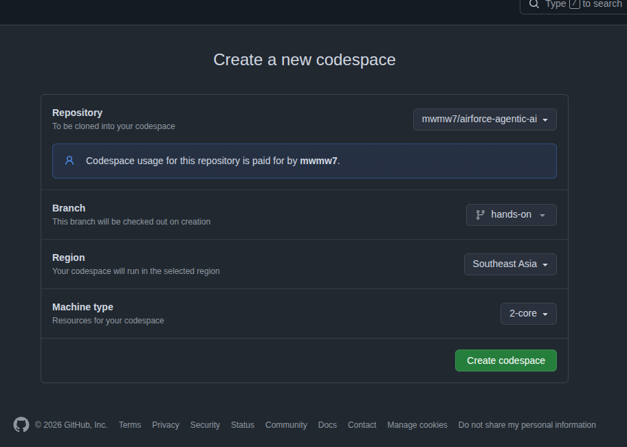

# 공군 AI센터 · Agentic AI 설계·구현 실무 — 핸즈온 저장소

2026. 10. 29(목) ~ 30(금) · TypeScript · LangGraph.js · MCP · Jev · Hindsight

**실습 시작 (설치 없음, 브라우저만):** 아래 버튼 또는 주소를 열고 **Create codespace** — 자세한 안내는 [1-2 절](#1-2-가장-빠른-길--github-codespaces-설치-없음-권장)

[](https://codespaces.new/mwmw7/airforce-agentic-ai?ref=hands-on)

```
https://codespaces.new/mwmw7/airforce-agentic-ai?ref=hands-on
```

> 이 저장소의 모든 데이터(레이더 화면·기상·규정집)는 **교육용 합성 자료**이며 실제 공역·부대·기종·규정과 무관합니다.
> Agent 는 **권고**까지만 수행하고, 결정은 항상 사람이 합니다.

---

## 처음 오신 분께 — 수업을 즐기기 위한 기본

### 오늘 만드는 것

관제실에 "서울 상공에 둥근 비행체가 떠 있어요" 같은 **보고 한 줄**이 들어오면, AI Agent 가 레이더 · 날씨 · 규정집을 스스로 찾아보고 근거를 모아 "출격 / 감시 / 무시" 의견을 냅니다. **마지막 결정은 언제나 사람**이 합니다.

거의 빈 Agent 에서 출발해 강사와 함께 **8단계**로 하나씩 붙입니다. 한 단계를 채울 때마다 다시 돌리면 담당자 화면에 근거가 한 줄씩 늘어납니다. 끝나면 요즘 Agent 의 핵심 부품(Tool Calling · MCP · RAG · Subagent · 사람 승인 · 기억)을 모두 내 손으로 한 번씩 붙여 본 셈이 됩니다.

### 걱정하지 않아도 되는 것

- **TypeScript 를 몰라도 됩니다.** 빈칸은 한 곳에 몇 줄이고, 주석에 할 일이 적혀 있으며, 강사가 화면에서 같이 칩니다. 코드를 외우기보다 "어디에 무엇이 붙는지" 를 보는 수업입니다
- **설치가 필요 없습니다.** GitHub Codespaces 가 브라우저 안에 개발 환경을 통째로 띄워 줍니다
- **API 키가 없어도 끝까지 돕니다.** 키가 없으면 **mock 모드**(정해진 답을 돌려주는 가짜 모델)로 모든 단계가 돌아갑니다. 실제 모델 키는 강사가 당일 조별로 나눠 줍니다
- **늦어도 따라잡을 수 있습니다.** `pnpm step <단계>` 한 줄이면 앞 단계는 정답으로 채워진 상태로 넘어갑니다
- **에러는 정상입니다.** 빨간 줄이 나오면 읽어 보고, 모르겠으면 손을 들어 주세요. 고치는 과정도 수업입니다

### 수업 전에 해 둘 것 (5분)

- [ ] **GitHub 계정** 만들기 · 로그인 확인 — https://github.com/signup (Codespaces 는 개인 계정이면 달마다 60시간 무료, 이틀 수업은 10시간이면 충분)
- [ ] 노트북에 **Chrome 또는 Edge** 최신판
- [ ] 미리 한 번 열어 보기 — [1-2 절](#1-2-가장-빠른-길--github-codespaces-설치-없음-권장) 대로 Codespace 를 만들고 "준비 끝" 이 뜨는지 확인 (첫 생성은 2~3분, 한 번 만들어 두면 당일엔 다시 열기만 하면 됩니다)
- [ ] (선택) 회사·기관 네트워크에서 github.com 이 막혀 있다면 미리 알려 주세요

### 꼭 알아 둘 용어 12개

| 용어 | 한 줄 뜻 | 오늘 코드에서 |
|---|---|---|
| **LLM** | 글을 읽고 다음 글을 써 주는 언어 모델 (ChatGPT · Claude 같은 것) | `src/lib/llm.ts` |
| **Agent** | LLM 이 "다음에 뭘 할지" 스스로 고르며 일을 끝까지 해내는 프로그램 | 이 저장소 전체 |
| **Tool (도구)** | LLM 이 부를 수 있는 함수. 모델은 "이 도구를 이 값으로 불러 줘" 라고 **말만** 하고, 실행은 내 코드가 한다 | `look_radar` · `look_weather` … |
| **Agent Loop** | 모델에게 묻기 → 도구 실행 → 결과를 다시 모델에게, 를 "다 확인했다" 할 때까지 반복 | `agent ⇄ tools` |
| **Graph · Node · Edge** | LangGraph 의 그림. 노드 = 할 일 한 칸, 엣지 = 다음으로 가는 화살표 | `addNode` · `addEdge` |
| **State (칠판)** | 노드들이 같이 읽고 쓰는 칠판. 노드는 칠판에 자기 결과를 적고 다음 노드에 넘긴다 | `labs/agent/state.ts` |
| **Worker · Subagent** | 일을 나눠 맡는 일꾼. 안에 모델 루프가 없으면 Worker, 있으면 Subagent | `searchDocs` · `askRadar` |
| **RAG** | 질문과 관련된 문서를 먼저 찾아서 근거로 넣어 주기 | 규정집 찾기 (`search-docs.ts`) |
| **MCP** | 도구를 다른 프로그램(서버)에 두고 표준 방식으로 빌려 쓰는 약속. USB 처럼 꽂으면 도구가 생긴다 | 날씨 서버 (`mcp-servers/weather`) |
| **Jev** | 질문에 출격/감시/무시 같은 **정해진 답과 확률**로 답하는 판정 모델. LLM 보다 빠르고 답이 흔들리지 않는다 | `src/lib/jev.ts` |
| **HITL (Human-in-the-Loop)** | 중요한 순간에 Agent 가 멈추고 사람에게 묻기. 멈춘 곳은 저장(Checkpoint)되어 나중에 이어갈 수 있다 | `approve` 노드 |
| **Memory (기억)** | 지난번 판단을 남겨 두었다가 같은 보고가 오면 다시 묻지 않고 그대로 쓰기 | Hindsight (`src/lib/memory.ts`) |

### 터미널 화면 읽는 법

`pnpm agent` 를 치면 줄마다 앞에 **꼬리표**가 붙습니다. 꼬리표만 따라 읽어도 Agent 가 무엇을 했는지 보입니다.

```
[REPORT] 서울 상공에 정체불명의 둥근 비행체가 떠 있어요 …      ← 들어온 보고
[SETUP ] 모델 mock · Jev local · 기억 file                      ← 지금 어떤 모드로 도는지
[TOOL  ] search_docs(보고 그대로)                                ← 규정집 찾기 (Worker)
[SUB   ] ┏━ askRadar 레이더 Subagent                             ← 여기부터 ┃ 줄은 Subagent 의 일
┃ [LLM   ] 1회째 → 도구 쓰기: look_radar                          ← 모델이 도구를 고름
┃ [TOOL  ] look_radar(…)                                          ← 내 코드가 실행
┃ [MCP   ] look_weather(…)                                        ← MCP 서버의 도구
[SUB   ] ┗━ askRadar 끝 · 모델 4회 호출                           ← 결론만 부모에게
[MEMORY] 같은 사례 없음 → Jev 에게 묻는다                         ← 기억 확인
[JEV   ] ▶ scramble 65% …                                         ← 판정 모델의 의견
[RULE  ] 조건 scramble → 출격 준비!                               ← 코드 규칙의 권고
[HUMAN ] 종합 — 담당자가 결정합니다                               ← 사람에게 묻는다 (y / w / n)
[DECIDE] …                                                        ← 사람이 고른 결과
```

`[STOP]` 은 코드가 강제로 멈췄다는 뜻(호출 한도 · 시간 초과)이고, `--watch` 를 붙이면 `[NODE]` 줄에 노드마다 칠판에 들어간 값 · 나온 값이 보입니다.

### 한 단계는 이렇게 진행됩니다

1. 강사가 "N단계 시작합니다" 하고 개념을 설명합니다
2. 파일을 엽니다 — VS Code 에서 `Ctrl+P` (Mac `Cmd+P`) 를 누르고 파일 이름(`main.ts` 등)을 칩니다
3. 빈칸을 찾습니다 — `Ctrl+F` 로 `TODO N` 검색. `// ===== TODO N: … =====` 아래 주석에 할 일이, `[여기에 코드를 작성하세요]` 자리에 쓸 곳이 있습니다
4. 강사와 같이 채우고 저장(`Ctrl+S`)
5. 터미널에서 `pnpm agent` → **담당자 화면(`[HUMAN]`)에 새 줄이 생기면 성공**

### 막혔을 때

| 상황 | 이렇게 |
|---|---|
| 정답이 궁금하다 | `git diff hands-on main -- labs/agent/main.ts` — 내 코드와 정답을 나란히 (파일 경로만 바꿔서) |
| 진도를 놓쳤다 | `pnpm step <지금 단계>` — 앞 단계가 풀린 상태로 맞춰진다 (덮어쓰기 전에 묻는다) |
| 실행이 멈추지 않는다 | 터미널에서 `Ctrl+C` |
| 담당자 질문에서 멈췄다 | 정상입니다. `y`(출격) · `w`(감시) · `n`(무시) 중 하나를 치고 Enter |
| 점심 뒤 화면이 꺼졌다 | Codespace 는 30분 쉬면 잠듭니다. 같은 주소로 다시 열면 파일은 그대로 |
| 그래도 모르겠다 | 손을 들어 주세요. 옆 사람과 같이 봐도 좋습니다 |

### 터미널 기본 몇 가지

- 이전 명령 다시: `↑` 키
- 터미널 하나 더: 터미널 창 오른쪽 위 `+` (날씨 MCP 서버를 켜 둘 때)
- 터미널에서 `Ctrl+C` 는 "복사" 가 아니라 **"멈춤"** 입니다. 복사는 드래그 후 마우스 오른쪽 버튼, 붙여넣기는 `Ctrl+V` (브라우저가 처음 한 번 허락을 물을 수 있음)
- 이 README 의 `pnpm …` 명령은 모두 저장소 맨 위 폴더에서 칩니다 (Codespaces 는 처음부터 거기서 열립니다)

### 수업이 끝나면

- 내 코드를 남기고 싶으면 VS Code 왼쪽 **Source Control** 에서 commit → push (내 fork 가 자동으로 생깁니다)
- 다 썼으면 https://github.com/codespaces 에서 내 Codespace 를 **Stop** 또는 **Delete** — 무료 시간을 아낄 수 있습니다
- 완성본은 언제든 `main` 브랜치에 있습니다. 집에서 다시 해 보려면 같은 링크로 새 Codespace 를 만들면 됩니다

---

## 0. 브랜치 안내 — 먼저 읽어 주세요

| 브랜치 | 용도 | 누가 |
|---|---|---|
| `main` | **완성본.** 모든 코드가 채워진 정답 | 강사 · 막힌 교육생 |
| `hands-on` | **실습용.** `main` 과 같지만 핵심 몇 곳이 비어 있고 주석으로 할 일이 적혀 있음 (`[여기에 코드를 작성하세요]`) | 교육생 |

교육생은 `hands-on` 브랜치에서 실습합니다. 막히면 정답을 보세요. 파일 경로가 같으니 내 코드와 정답을 나란히 비교할 수 있습니다.

```bash
git diff hands-on main -- labs/agent/main.ts
```

---

## 1. 5분 시작 가이드

### 1-1. 준비물 (교육 1주 전에 미리)

| 필수 | 선택 |
|---|---|
| Node.js **22 LTS** 이상 (`node -v`) | Ollama + `ollama pull qwen3:8b` (내 노트북 모델로 바꿔 보기) |
| git, VS Code | LangSmith 무료 계정 (LangGraph Studio · 실행 기록 보기) |
| 강사가 나눠주는 조별 토큰 (`.env` 에 입력) | `uv` (Hindsight 기억 서버를 내 노트북에서 띄울 때, https://docs.astral.sh/uv/) |

로컬 LLM 은 설치하지 않아도 됩니다. 모델은 OpenRouter 로 부르고, 강사가 조별 키(지출 상한 걸린)만 나눠 드립니다.

### 1-2. 가장 빠른 길 — GitHub Codespaces (설치 없음, 권장)

[](https://codespaces.new/mwmw7/airforce-agentic-ai?ref=hands-on)

GitHub 계정만 있으면 됩니다. Windows · Mac · Linux 상관없이 **브라우저만 있으면 됩니다.** 위 배지(또는 https://codespaces.new/mwmw7/airforce-agentic-ai?ref=hands-on )를 열면 아래 화면이 뜹니다. 브랜치가 `hands-on`, 머신이 `2-core` 인지 확인하고 **Create codespace** 를 누르세요.



2~3분 뒤 브라우저에 VS Code 가 열리고, 아래 터미널에서 **설치 · `.env` · 환경 점검이 자동으로 끝납니다** (`.devcontainer/` 가 그 레시피). "준비 끝" 이 보이면 `pnpm agent` 를 치세요. 날씨 MCP 는 터미널을 하나 더 열어(`+`) `pnpm mcp:weather`.

- fork 는 필요 없습니다. 수업 중 강사가 고친 내용은 `git pull` 로 받습니다. 끝나고 남기고 싶으면 push 할 때 자동으로 내 fork 가 생깁니다
- 개인 계정은 달마다 2-core 기준 60시간이 무료입니다 (이틀 교육은 10시간 안팎). 한도를 넘어도 요금이 나가지 않고 멈춥니다
- 30분 동안 아무것도 안 하면 잠듭니다(점심시간). 다시 열면 파일은 그대로, 켜 둔 `pnpm mcp:weather` 만 다시 켜세요
- 토큰·키는 `.env` 에 넣거나, GitHub **Settings → Codespaces → Secrets** 에 같은 이름(`LLM_API_KEY` 등)으로 넣으면 `.env` 보다 우선합니다
- `pnpm see:run`(3030) · 날씨 MCP(3333) · Studio(2024) 포트는 Codespaces 가 알아서 열어 줍니다
  - `pnpm see:run` — 돌리면서 보기. 브라우저 탭이 자동으로 열림 (계정 필요 없음)
  - `pnpm see:graph` — 그림만. `docs/graphs/agent.md` 를 열고 `Ctrl+Shift+V` (Mermaid 미리보기 확장이 미리 깔려 있음)
  - `pnpm see:studio` — 공식 디버거. 2024 포트를 공개로 바꾸고 Studio 주소를 찍어 준다 (LangSmith 로그인 필요). 공개 주소는 누구나 접속 가능하니 시연 후 Ctrl+C

### 1-3. 노트북에 직접 설치

```bash
git clone https://github.com/mwmw7/airforce-agentic-ai.git
cd airforce-agentic-ai
git checkout hands-on        # 실습용 브랜치 (빈칸 버전)
corepack enable && corepack prepare pnpm@12.6.0 --activate   # pnpm 이 없다면 (Node 22 내장 corepack)
pnpm install
pnpm setup:check             # 환경 점검 + .env 생성 (토큰은 당일 강사가 배포. 없어도 mock 모드로 전부 실행됩니다)
```

`[문제]` 가 없으면 준비 완료입니다. `[참고]` 는 "네트워크 없이 도는 대체 모드" 라는 뜻이라 실습에는 지장이 없습니다.

### 1-4. 첫 실행

```bash
pnpm mcp:weather                 # 터미널 1: 날씨 MCP 서버 (켜 둔 채로 둔다. 없으면 agent 는 날씨 없이 돈다)
pnpm agent                       # 터미널 2: 보고 1번 → LLM 이 레이더·규정집·날씨 확인 → Jev 판정 → 출격이면 사람이 승인(y/n)
pnpm agent 3                     # 보고 3번 (1~4), 또는 pnpm agent "한강에 오리 풍선이 떠요" 처럼 내 보고
pnpm agent:limit                 # 호출 한도 1 로 강제 중단 — 멈추는 건 모델이 아니라 코드
pnpm agent --watch               # 단계(노드)마다 들어간 값·나온 값을 보여 주며 실행 (--watch=full 이면 전부)
pnpm agent --resume <실행번호>    # 담당자 확인 중 Ctrl+C 로 껐던 실행을 멈춘 곳부터 이어가기 (명령은 질문 바로 위 SETUP 줄에 찍힌다, 7단계 뒤)
pnpm agent --all                 # 보고 4종을 차례로 돌리고 표로 정리. 건마다 사람이 y/w/n 을 답한다 (--answer w 를 주면 자동). JEV_MODE=local 과 typesafe 로 두 번 돌려 비교
LLM_MOCK_SLOW=1 pnpm agent       # 모델이 늦는 상황 시연 → 끊고 담당자에게 retry / skip / stop 을 묻는다
```

옵션 전체 표는 4장 「`pnpm agent` 옵션 전부」에 있습니다.

그래프를 **눈으로 보는** 명령은 `see:` 로 시작합니다.

| 명령 | 하는 일 | 에이전트 실행 | 어디서 보나 | 계정 |
|---|---|---|---|---|
| `pnpm see:run` | 돌리면서 보기 — 그래프 그림 위에 지금 도는 단계가 켜진다. 보고를 무작위로 계속 돌림 (Ctrl+C 로 끝) | 함 | 브라우저 localhost:3030 | 필요 없음 |
| `pnpm see:graph` | 그림만 그리기 — 선을 바꾼 뒤 모양 확인 | 안 함 | `docs/graphs/agent.md` (VS Code 미리보기) | 필요 없음 |
| `pnpm see:studio` | 공식 디버거 LangGraph Studio — 입력을 넣고 한 단계씩 돌리기 · 칠판 보기. Codespace 면 포트 공개와 주소까지 알아서 | Studio 에서 | smith.langchain.com | LangSmith (`.env` 의 `LANGSMITH_API_KEY`) |

`hands-on` 브랜치는 **거의 빈 Agent** 에서 출발합니다. 빈칸이 비어 있어도 끝까지 돌고, 담당자 화면에 근거 줄이 비어 있을 뿐입니다. 단계마다 빈칸을 채우고 다시 돌리면 화면에 새 줄이 생깁니다. 늦었으면 `pnpm step <지금 단계>` 로 앞 단계는 풀린 상태로 넘어갑니다 (3장).

Studio 의 Input 에는 보고 한 줄만 넣습니다.

```json
{ "report": "서울 상공에 정체불명의 둥근 비행체가 떠 있어요. 움직이지도 않고 무전에 대답도 없어요." }
```

---

## 2. 내 에이전트 — 한눈에

관제실에 보고 한 줄이 들어오면, **규정집 Worker 와 레이더 Subagent 가 동시에** 자료를 모으고, 전에 똑같은 보고를 판단한 기억이 있으면 그 판단을 그대로 쓰고(Jev 생략), 없으면 판정 모델이 의견을 냅니다. **언제나 마지막은 사람**이 모든 근거를 한눈에 보고 출격 / 감시 / 무시 를 고릅니다. 사람이 고른 뒤에야 LLM 이 그 사실로 브리핑 보고서를 써서 `reports/` 에만 남깁니다.

```
         ┌─▶ searchDocs  (Worker: 함수 하나, 규정집 찾기)                      ─┐
START ───┤                                                                    ├─▶ remember ─┬─ 같은 사례 기억 있음 ──────┐ (Jev 생략)
         └─▶ askRadar    (Subagent, 안에서 agent ⇄ tools 를 반복) ─┘             └─ 없음 ─▶ judge (Jev) ───┴─▶ approve ─▶ writeReport ─▶ END
                                                                                     approve = 레이더 · 확대 · 날씨 · 규정 · 기억 · Jev 를 모아 보여 주고 사람이 결정
                                                                                     writeReport = 사람의 결정 뒤 LLM 이 브리핑 문장을 써서 reports/ 에만 저장

askRadar 안 (labs/agent/ask-radar.ts):
  START ─▶ agent ─┬─ 도구 쓰고 싶다   ─▶ tools ─▶ agent … (반복)
                  ├─ 다 확인했다     ─▶ END   (facts · evidence 만 들고 부모에게 돌아간다. 대화 기록은 Subagent 안에 남는다)
                  ├─ 너무 많이 돌았다 ─▶ stop  ─▶ END   (내 코드가 강제로 멈춤 — Subagent 만 멈추고 부모는 계속)
                  └─ 모델이 늦다     ─▶ askHuman ─▶ 사람이 고름: retry → agent / skip → END / stop → stop
```

Worker 와 Subagent 는 LangGraph 에겐 똑같이 "노드 하나" 입니다. 안에 모델 루프가 있으면 우리가 Subagent라고 부를 뿐입니다. 터미널에서는 Subagent 가 도는 동안 `[SUB] ┏━ askRadar` 띠가 열리고, 그 사이 모든 줄 앞에 보라색 `┃` 가 붙었다가 `┗━ askRadar 끝` 에서 닫힙니다. searchDocs 는 띠 밖에서 한 줄에 끝나고, `--watch` 면 띠 안에 `askRadar › agent`, `askRadar › tools` 가 여러 줄 찍힙니다.

| 단계 (노드) | 하는 일 | 배우는 것 |
|---|---|---|
| `searchDocs` (Worker) | 보고 한 줄로 규정집에서 관련 규정을 찾아 근거에 넣기. 모델 호출 없음, 함수 하나 | Task Decomposition — 정해진 일은 함수가 |
| `askRadar` (Subagent) | 아래 agent ⇄ tools 루프를 통째로 감싼 Subagent 그래프. 부모에겐 facts · evidence · steps 만 돌려준다 | Subagent · Context 분리 (팀장 칠판은 결론만) |
| `agent` (Subagent 안) | 모델에게 "도구를 더 쓸래, 사실을 정리할래?" 묻기 | Agent Loop · Tool Calling |
| `tools` (Subagent 안) | 모델이 고른 도구를 **내 코드가** 실행. 로컬 도구(레이더 보기·확대)와 MCP 도구(날씨)가 한 목록에 섞여 있다 | 모델은 부르겠다고 말할 뿐, 실행은 내 코드 |
| `remember` | 기억에서 같은 사례 찾기(`findSameCase`). 보고 겹침 0.9 이상이면 그때의 판정을 그대로 쓰고 Jev 를 건너뜀 | 장기 기억으로 판단하기 (같은 사례 = 코드 규칙) |
| `judge` | 비슷한 기억을 참고로(recall) Jev 에게 3가지 질문(출격/감시/무시 · 위험도 · 정체불명 확률), 끝나면 기억에 남김(retain) | 판정 모델 · 장기 기억 |
| `approve` | **언제나** 멈춰서 레이더 · 확대 · 날씨 · 규정 · 기억 · Jev 의견 · 코드 권고를 한눈에 보여 주고, 사람이 y(출격) / w(감시) / n(무시) 를 고름. 사람의 답이 기억에 남음 | Human-in-the-Loop (`interrupt`) |
| `writeReport` | 사람이 결정한 뒤 한 번. 결정 · 시각은 코드가 머리말에 박고, LLM 은 approve 가 보여 준 사실 목록으로 브리핑 문장만 씀. `reports/<실행번호>.md` 에만 저장(밖을 가리키면 거부). 모델이 실패하거나 mock 이면 사실 목록을 그대로 저장 | 사실은 코드가, 문장은 LLM 이 · Sandbox |
| `askHuman` (Subagent 안) | 모델이 늦으면 멈추고 retry / skip / stop 묻기. Subagent 안의 interrupt 도 부모 실행번호로 저장·재개된다 | 시간 초과 · 사람 개입 |
| `stop` (Subagent 안) | MAX_STEPS 를 넘기면 Subagent 만 강제 종료. 부모는 규정집 결과만 들고 판정으로 | Harness — 멈추는 건 코드 · 장애 격리 |

그림: `docs/graphs/agent.md` (`pnpm see:graph` 로 다시 생성)

### 도구 4개 + Worker 1개

| 도구 | 어디서 실행 | 자료 |
|---|---|---|
| `look_radar` 보고에 나온 장소로 레이더 보기 | 로컬 (`ask-radar.ts`) | 실제 모델이면 **LLM 이 보고에 맞춰 레이더 화면을 지어냄** (실행마다 한 번, 확대와 앞뒤가 맞음). mock·실패 시 `data/api/radar-screen.json` |
| `look_closer` 한 자리 확대 | 로컬 (`ask-radar.ts`) | 〃 |
| `look_flight_plan` 오늘 통보·허가된 비행 계획 조회 (2단계에서 직접 붙인다) | 로컬 (`ask-radar.ts`) | `data/api/flight-plans.json` — 잠실 드론 쇼는 **신청 없음** |
| (Worker) `searchDocs` 규정집 찾아보기 (RAG) — 모델이 고르는 도구가 아니라 부모 그래프가 항상 돌리는 노드 | 로컬 (`search-docs.ts`) | `data/docs/rulebook.md` |
| `look_weather` 그 장소의 날씨 보기 | **MCP 서버** (`mcp-servers/weather`) | 서버 안에서 **LLM 이 장소·상황에 맞춰 지어냄**. mock·실패 시 규칙표 |

### 보고 4종 (`labs/agent/main.ts` 의 REPORTS)

| # | 보고 | 보는 포인트 |
|---|---|---|
| 1 | 서울 상공 정체불명 둥근 비행체, 무응답 | "서울" 로 레이더를 보면 남산 물체 + 광화문 헬기 두 건 → 확대해서 가려낸다 → Jev 출격 권고 → 사람이 결정. **두 번 돌리면 두 번째엔 기억으로 판단(Jev 생략)** |
| 2 | 한강 위 거대한 오리 풍선, 김포 쪽으로 | 규정집에 "풍선은 감시" 가 있다 |
| 3 | 잠실 상공 드론 수십 대 | 비행 계획(`look_flight_plan`)에 드론 쇼 신청이 없다 → 규정집 "허가 없는 드론 떼는 감시" |
| 4 | 옆 부대 훈련기, 예정 코스 정상 | 별일 아님 |

---

## 3. 실습 순서 — 같이 하나씩 붙이기 (TODO 번호 = 단계 번호)

강사와 함께 한 단계씩 붙이고, 매번 `pnpm agent` 로 다시 돌려 **담당자 화면에 새 줄이 생기는 것**을 확인합니다. 단계별 코드 · 확인 방법은 `docs/exercises.md`.

| 단계 | 같이 붙이는 것 | 파일 (TODO) | 화면에 생기는 것 | 개념 |
|---|---|---|---|---|
| 0 | (없음) 환경 · 구조 · 첫 실행 | — | 보고만 있고 근거가 빈 담당자 화면 | 전체 구조 |
| 1 | 레이더 Subagent 데려오기 `addNode("askRadar", radarAgent)` | `main.ts` (1) | `[SUB] ┏━ askRadar` 띠, 레이더 · 확대 줄 | Subagent · Agent Loop |
| 2 | Subagent 에게 새 도구 `look_flight_plan` — 설명 + 실행 | `ask-radar.ts` (2-1 · 2-2) | `[TOOL] look_flight_plan`, 비행 계획 줄 | Tool Calling — 설명이 선택을 정한다 |
| 3 | 규정집 줄마다 점수 매기기 | `search-docs.ts` (3) | 관련 규정 줄 (`pnpm agent 2`) | RAG |
| 4 | 날씨를 MCP 로 — 서버에 등록 + 목록 받기 · 실행 | `server.ts` (4-1) · `mcp.ts` (4-2) | 날씨 줄 (`pnpm mcp:weather` 켜고). 끄면 "날씨 없이 계속" | MCP |
| 5 | 순차를 동시로 + 합류 | `main.ts` (5) | `--watch` 에서 searchDocs · askRadar 가 같이 시작 | Task Decomposition · 병렬 |
| 6 | Jev 에게 묻기 `askJev(…, QUESTIONS)` | `main.ts` (6) | Jev 판정 줄 (확신도 · 위험도 · 정체불명) | 판정 모델 |
| 7 | 사람의 답으로 이어가기 `Command({ resume })` | `main.ts` (7) | "사람이 결정". Ctrl+C → `pnpm agent --resume <번호>` | HITL · Checkpoint |
| 8 | 기억 찾기 · 남기기 | `main.ts` (8-1 · 8-2) | 같은 보고 두 번째엔 "같은 사례 찾음 → Jev 생략" | Context · Memory |

**따라잡기 — `pnpm step <지금 단계>`:** 강사가 "4단계 시작합니다" 하면 늦은 사람은 `pnpm step 4`. 1 ~ 3 은 풀린 상태, 4 부터 할 차례가 된다 (정답은 main 에서 가져온다).

| 명령 | 상태 |
|---|---|
| `pnpm step 1` | 1 ~ 8 전부 남음 (처음 상태) |
| `pnpm step 4` | 1 ~ 3 풀림, 4 번부터 |
| `pnpm step 8` | 1 ~ 7 풀림, 8 번만 남음 |
| `pnpm step done` | 전부 풀림 (main 과 같음) |

빈칸이 든 파일만 덮어쓰며, 먼저 묻습니다.

완성 코드로 제공 (설명 · 시연): 도구 실행 루프와 MAX_STEPS 강제 중단(`ask-radar.ts` — 1일차 Loop 그대로, `pnpm agent:limit`), 모델이 늦을 때 사람에게 묻기(`LLM_MOCK_SLOW=1`), 모델 교체, Studio.

---

## 4. 자주 쓰는 명령

```bash
pnpm mcp:weather             # 날씨 MCP 서버 (http://localhost:3333/mcp)
pnpm mcp:inspect             # MCP Inspector — 화면에서 Streamable HTTP + 위 주소를 넣고 look_weather 를 직접 눌러 본다
pnpm memory:up               # Hindsight 기억 서버를 내 노트북에 띄운다 (uv 필요, 첫 실행 약 200MB) → .env MEMORY_MODE=hindsight
pnpm memory:ui               # Hindsight 대시보드 http://localhost:18888 — retain 된 기억(사실·요약·링크)과 서버 작업을 눈으로 본다 (끄기: pnpm memory:ui:stop)
pnpm memory:reset            # 기억 전부 지우고 처음부터 (현재 MEMORY_MODE 의 저장소 + checkpoints.sqlite). --all 이면 서버 bank 와 파일 둘 다
pnpm agent --watch=full      # 들어간 값·나온 값을 자르지 않고 전부
pnpm see:graph               # 그래프를 Mermaid 그림으로 (docs/graphs/)
pnpm typecheck               # 타입 검사
pnpm setup:check             # 환경 점검
```

### `pnpm agent` 옵션 전부

`pnpm agent` 는 `labs/agent/main.ts` 를 실행합니다. 아래 표가 코드가 읽는 옵션의 전부입니다. 실행 방식은 `--live` → `--all` → `--resume` → 보고 인자 순으로 먼저 있는 것 하나만 적용됩니다.

**어떤 보고를 돌릴지 (옵션 없이 붙이는 인자)**

| 쓰는 법 | 하는 일 |
|---|---|
| `pnpm agent` | 보고 1번 |
| `pnpm agent 3` | 보고 3번 (1~4. 범위 밖이면 1번) |
| `pnpm agent "한강에 오리 풍선이 떠요"` | 내가 쓴 문장을 보고로 |

**옵션 (`--` 로 시작)**

| 옵션 | 하는 일 | 언제 쓰나 |
|---|---|---|
| `--watch` | 단계(노드)마다 들어간 값·나온 값을 요약해서 보여 준다. Subagent 안은 `askRadar › agent` 처럼 찍힌다 | 빈칸을 채운 뒤 칠판이 어떻게 바뀌는지 볼 때 |
| `--watch=full` | 위와 같지만 자르지 않고 전부 | 값이 잘려서 안 보일 때 |
| `--all` | 보고 4종을 차례로 돌리고 표 하나로 정리 | `JEV_MODE` 를 바꿔 두 번 돌려 비교할 때 |
| `--answer <y\|w\|n>` | 담당자 질문에 답을 미리 정해 둔다. 묻지 않고 바로 그 답을 쓴다 (`y` 출격 · `w` 감시 · `n` 무시) | `--all` 로 4건을 멈춤 없이 돌릴 때 |
| `--resume <실행번호>` | 담당자 확인 중 Ctrl+C 로 껐던 실행을 멈춘 곳부터 이어간다 (`checkpoints.sqlite`). 실행번호는 SETUP 줄에, 이어가는 명령은 질문 바로 위에 찍힌다 (7단계를 채운 뒤부터) | 단계 7 (Checkpoint · 재개) |
| `--live` | 브라우저(http://localhost:3030)에 그래프를 띄우고 보고를 무작위로 계속 돌린다 (Ctrl+C 로 끝). `pnpm see:run` 이 이 옵션을 붙인 것 | 그래프가 도는 모습을 눈으로 볼 때 |

옵션은 섞어 쓸 수 있습니다. 예: `pnpm agent 2 --watch`, `pnpm agent --all --answer w`, `pnpm agent --resume loop-1-1234567890 --watch`.

**같이 쓰는 환경 변수 (명령 앞에 붙이거나 `.env` 에)**

| 변수 | 기본값 | 하는 일 |
|---|---|---|
| `LLM_MODE` · `JEV_MODE` · `MEMORY_MODE` | `.env` | 모델 · Jev · 기억을 어떤 걸로 돌릴지 (5장) |
| `MAX_STEPS` | `8` | Subagent 안 agent ⇄ tools 루프 최대 횟수. `pnpm agent:limit` 이 `1` 로 놓고 돌리는 것 |
| `RUN_TIMEOUT_SEC` | `180` | 실행 전체가 이 초를 넘으면 끊는다 |
| `LLM_TIMEOUT_SEC` | `60` | 모델 호출 한 번의 제한 시간. 넘으면 Subagent 가 담당자에게 retry / skip / stop 을 묻는다 |
| `LLM_MOCK_SLOW` | 없음 | `1` 이면 mock 모델이 매번 늦게, `once` 면 첫 호출만 늦게 → "모델이 늦을 때 사람에게 묻기" 시연 |
| `LIVE_PORT` | `3030` | `--live` 가 여는 포트 |
| `NO_COLOR` | 없음 | 값을 아무거나 주면 터미널 색을 끈다 |

Claude Code 에 같은 MCP 서버 꽂기: `claude mcp add --transport http weather http://localhost:3333/mcp`

기억 실험: `.hindsight/control-room.json` 을 지우고 보고 1 을 돌리면 "같은 사례 없음 → Jev 에게 묻는다", 한 번 더 돌리면 "기억 판단 … Jev 생략" 으로 Jev 없이 판단합니다. 첫 번째에 출격을 **반려(n)** 하면 두 번째엔 "감시" 로 떠오릅니다 — 사람의 결정이 기억을 고칩니다. `pnpm see:run` 에서는 remember 노드 아래 기억 카드(그때 보고 · 일치도 · 그때 확신)로 보입니다. Hindsight 모드의 그래프는 `npx @vectorize-io/hindsight-control-plane --api-url http://localhost:8888` (localhost:9999) 에서 그림으로 봅니다.

---

## 5. 모델·판정기·기억 바꾸기 (.env 세 줄)

| 설정 | 기본 (키 없이) | 강사 제공 | 폐쇄망으로 옮길 때 |
|---|---|---|---|
| `LLM_MODE` | `mock` (정해진 답) | `cloud` — OpenRouter + 조별 키 | `relay` — vLLM 등 OpenAI 호환 주소 |
| `JEV_MODE` | `local` (규칙 판정기) | `openrouter` — Jev (OpenRouter Decisions API, 같은 조별 키를 `OPENROUTER_API_KEY` 에) | `src/lib/jev.ts` 의 `localJudge` 자리에 자체 모델 |
| `MEMORY_MODE` | `file` (`.hindsight/*.json`) · `off` (기억 없음) | `hindsight` — `pnpm memory:up` 또는 강사 서버 주소 | 자체 호스팅 Hindsight |

모델 비교: `LLM_MODE=ollama` + `LLM_BASE_URL=http://localhost:11434/v1` + `LLM_MODEL=qwen3:8b` 로 바꾸면 같은 보고를 노트북 모델로 돌려 봅니다.

실행 기록은 `traces/*.jsonl` 에 남습니다 (Langfuse 특강에서 확장). `.env` 에 `LANGSMITH_TRACING=true` 와 `LANGSMITH_API_KEY` 를 넣으면 같은 실행이 smith.langchain.com 에도 트리(노드 → LLM 호출 · Jev · MCP · 기억)로 올라갑니다. 코드 수정 없이 켜고 끕니다.

---

## 6. 저장소 구조

```
airforce-agentic-ai/
├─ src/lib/                 공용 모듈 — 폐쇄망으로 옮길 때 바꾸는 곳이 전부 여기
│  ├─ llm.ts                 LLM (OpenRouter(cloud) / 자체 중계(relay) / Ollama / mock)
│  ├─ jev.ts                 Jev 판정 모델 (TypeSafe SDK / OpenRouter / 로컬 규칙 판정기)
│  ├─ memory.ts              장기 기억 (Hindsight 서버 / 파일) — createBank · retain · recall · reflect
│  ├─ trace.ts               실행 기록 (traces/*.jsonl)
│  ├─ show.ts                --watch 출력
│  └─ live.ts · live.html    브라우저 실시간 보기 (pnpm see:run)
├─ labs/agent/
│  ├─ main.ts                부모 그래프 — 보고 → [searchDocs ‖ askRadar] → remember → judge → approve → writeReport (빈칸 1 · 5 · 6 · 7 · 8)
│  ├─ ask-radar.ts           레이더 Subagent — agent ⇄ tools 루프, 늦으면 askHuman, MAX_STEPS 면 stop, 도구 look_flight_plan (빈칸 2)
│  ├─ state.ts               부모 칠판(State). Subagent 는 여기에 자기 칸(대화)을 더해 쓴다 — 겹치는 칸만 부모로 돌아온다
│  ├─ search-docs.ts         규정집 찾아보기 + Worker 노드 (빈칸 3)
│  ├─ write-report.ts        사람의 결정 뒤 LLM 브리핑 보고서 → reports/ 에만 저장 (완성 코드)
│  └─ mcp.ts                 MCP 서버 접속 → 도구 목록 → 실행 (빈칸 4-2)
├─ mcp-servers/weather/server.ts   날씨 MCP 서버, Streamable HTTP (빈칸 4-1)
├─ data/                     교육용 합성 자료
│  ├─ api/                    레이더 화면(radar-screen.json)
│  └─ docs/rulebook.md        관제 규정 10줄
├─ .devcontainer/            Codespaces 레시피 — Node 22 상자 + setup.sh(설치 · .env · 점검 자동)
├─ docs/graphs/              그래프 그림 (pnpm see:graph)
├─ docs/plan.md · day2-handson.md   구현 계획 · 2일차 핵심 내용
├─ docs/slides/day2.html     2일차 강의 슬라이드 (47장, 브라우저로 열기. ← → 이동, 화면 왼쪽/오른쪽 클릭, O 전체보기) — pnpm slides 로 재생성 (python3)
├─ docs/slides/day2.pdf      같은 슬라이드 PDF (장마다 한 페이지) — pnpm slides:pdf 로 재생성 (Chrome 필요)
├─ docs/slides-plan.md       슬라이드 장 단위 계획
├─ checkpoints.sqlite        실행 저장 (LangGraph SqliteSaver, --resume 용. git 에 안 올라감)
├─ .hindsight/               file 모드 기억 (git 에 안 올라감)
├─ traces/                   실행 기록
├─ langgraph.json            LangGraph Studio 설정 (pnpm see:studio)
└─ tools/                    doctor(환경 점검) · make-handson(빈칸 만들기) · step(따라잡기) · blanks(빈칸 변환 공용) · draw-graph(그림) · memory-up(Hindsight 띄우기) · make-slides(강의 슬라이드)
```

---

## 7. 강사용 — 두 브랜치 관리

모든 작업은 `main` 에서 하고, `hands-on` 은 스크립트로 만듭니다.

```bash
git checkout main
# … 코드 수정 …
git commit -am "fix: …" && git push

git checkout hands-on
git checkout main -- .                # main 파일을 그대로 가져온 뒤
node tools/make-handson.mjs           # 표시된 정답 구간을 빈칸으로
git commit -am "handson: regenerate from main" && git push
```

`main` 에서 파일을 지우거나 옮겼다면 `hands-on` 에서도 같은 파일을 `git rm` 해 주세요 (`git checkout main -- .` 은 삭제를 옮기지 않습니다).
빈칸 목록 확인: `pnpm instructor:make-handson --check`. 표시 규칙은 `tools/make-handson.mjs` 상단 주석 참고.

---

## 8. 참고 링크

- LangGraph.js — https://langchain-ai.github.io/langgraphjs/
- LangSmith · Studio — https://docs.smith.langchain.com
- MCP TypeScript SDK — https://github.com/modelcontextprotocol/typescript-sdk
- Jev / TypeSafe — https://typesafe.ai
- Hindsight (Node 클라이언트 · 로컬 데몬) — https://hindsight.vectorize.io/sdks/nodejs · https://hindsight.vectorize.io/sdks/hindsight-all-npm
- Langfuse — https://langfuse.com/docs
