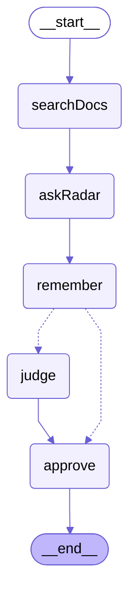
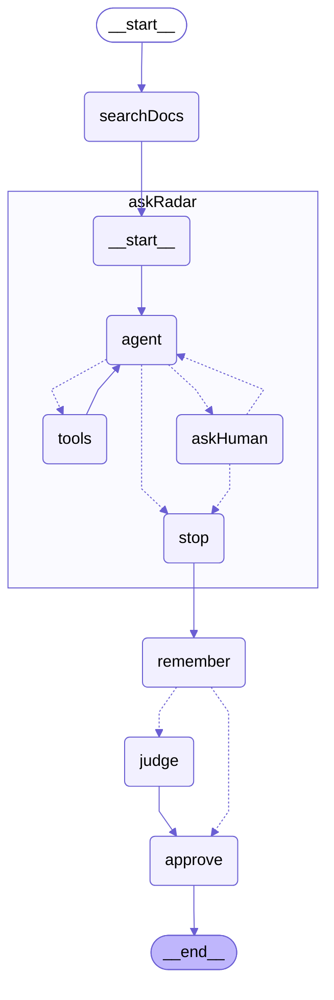
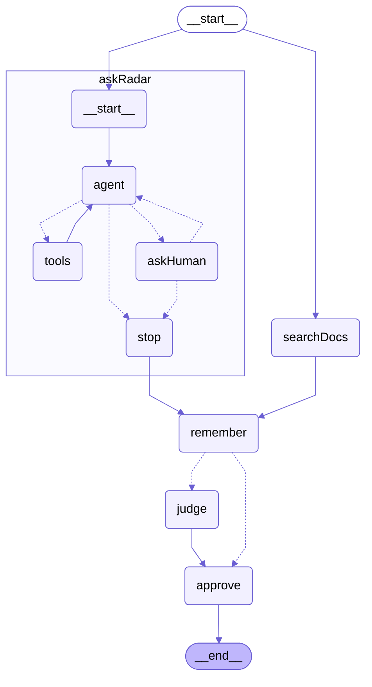

# 단계별 그래프 모양

`pnpm see:steps` 로 생성. 앞 단계와 모양이 같으면 그림을 생략한다.

## 단계 1: 처음 상태 — 전부 빈칸 (pnpm step 1)

## 단계 2: 2번을 풀 차례 — 1 정답 (pnpm step 2)

## 단계 3: 3번을 풀 차례 — 1 ~ 2 정답 (pnpm step 3)

_앞 단계와 모양이 같다 (바뀐 건 노드 안의 코드)_

## 단계 4: 4번을 풀 차례 — 1 ~ 3 정답 (pnpm step 4)

_앞 단계와 모양이 같다 (바뀐 건 노드 안의 코드)_

## 단계 5: 5번을 풀 차례 — 1 ~ 4 정답 (pnpm step 5)

_앞 단계와 모양이 같다 (바뀐 건 노드 안의 코드)_

## 단계 6: 6번을 풀 차례 — 1 ~ 5 정답 (pnpm step 6)

## 단계 7: 7번을 풀 차례 — 1 ~ 6 정답 (pnpm step 7)

_앞 단계와 모양이 같다 (바뀐 건 노드 안의 코드)_

## 단계 8: 8번을 풀 차례 — 1 ~ 7 정답 (pnpm step 8)

_앞 단계와 모양이 같다 (바뀐 건 노드 안의 코드)_

## 단계 done: 전부 정답 (pnpm step done)

_앞 단계와 모양이 같다 (바뀐 건 노드 안의 코드)_
